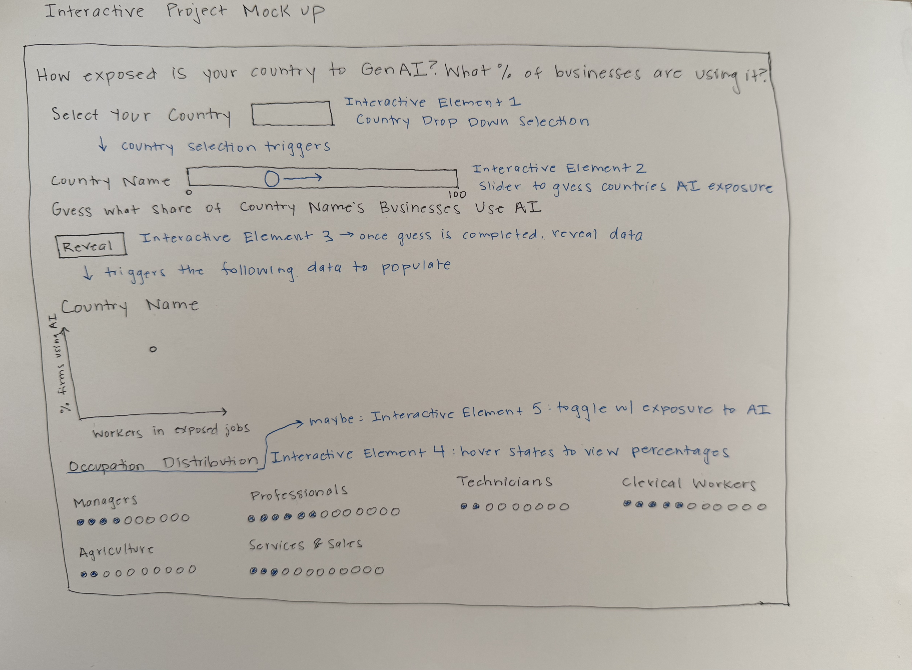

# Lily Rudin

## Description

I am planning on continuing to work with the same data sources from my static proposal to show how AI adoption has changed in countries over time, an interactive element for percentage saturation of certain job types in various countries and some interactive visualization to show the relationship between occupation types and country GDP. I am hoping to make the interactive version of this project feel more personal, like some of my inspiration sources (How much Hotter is your Hometown), by allowing users to select for country, gender and maybe even occupation.

## Technical Plan re: Option A/B/C/D

I am leaning towards option A: one large and highly interactive visualization. There are several data points I want to show and I think I will filter the data by country and maybe allow for comparisons. I plan on using D3 to create the interactive animations. 

### Libraries

- D3.js (v7) for all charts: the dot chart (positions computed in JavaScript, with d3.transition to animate dots between groupings), the drag-to-guess bar (d3.drag), and the scatter.
- Python (pandas) to clean and join the data ahead of time and export small JSON files for the page. This builds on the cleaning code from my static notebooks.
- Plain HTML/CSS for layout and text, hosted on GitHub Pages.

## Inspiration

FlowingData, "A Day in the Life of Americans": dots that move between groups to show how a population is split up. My "group by" toggle uses the same idea, with dots moving between occupation groups and exposure levels.
https://flowingdata.com/2015/12/15/a-day-in-the-life-of-americans/

NYT Upshot, "You Draw It: How Bad Is the Drug Overdose Epidemic?": asking readers to commit to a guess before the reveal. My Step 1 is a simpler one-bar version.
https://www.nytimes.com/interactive/2017/04/14/upshot/drug-overdose-epidemic-you-draw-it.html

NYT, "How Much Hotter Is Your Hometown Than When You Were Born?": personalization by letting readers pick their own place. Country selection and the job search play that role here.
https://www.nytimes.com/interactive/2018/08/30/climate/how-much-hotter-is-your-hometown.html 

## Mockup

## Data Sources

### Data Source 1: World Bank World Development Indicators (WDI)

URL: https://databank.worldbank.org/source/world-development-indicators

Size: ~33,000 rows, 8 columns (estimated: ~10 indicators × 217 economies × 2010–2024)

The WDI is the World Bank's primary collection of country-level development indicators, available through a free API with no key required. I will pull GDP per capita, internet use, education, and population. Each country includes a region and income group, which I'll use for aggregation and drill-downs.

### Data Source 2: ILO Generative AI Occupational Exposure Index + ILOSTAT Employment by Occupation

URL: https://www.ilo.org/node/706766 (exposure index, ILO Working Paper 140) and https://ilostat.ilo.org/data/ (employment data)

Size: Exposure index: ~430 rows, ~5 columns (one row per ISCO-08 occupation). ILOSTAT employment by sex and occupation: ~100,000 rows, ~8 columns (estimated: ~150 countries × 10 years × ~45 occupation categories × 3 sex categories)

The ILO's 2025 index scores occupations by their exposure to generative AI. Joining it to ILOSTAT employment data will give each country's share of workers in exposed occupations, by sex. Many countries report occupations only at the 1- or 2-digit level, so I may need to aggregate the scores.

### Data Source 3: OECD ICT Access and Usage by Businesses

URL: https://oe.cd/dx/ict-access-usage

Size: ~30,000 rows, ~15 columns (estimated, after filtering to AI-related indicators; SDMX CSV export)

Official survey data on enterprise AI use from 2005–2024, broken down by firm size and industry. Covers only ~40 OECD and partner countries, so detailed adoption analysis will focus on this group.

### Data Source 4: Stanford HAI AI Index Report 2026 (Public Data)

URL: https://hai.stanford.edu/ai-index/2026-ai-index-report

Size: ~3,000 rows, ~5 columns (estimated, after combining ~5 country-level series)

Annual Report on Stanford's Institute for Human-Centered AI that complies dara on AI research, investment, adoption, and policy. Data is published per chart, so I'll select and reshape country-level series such as private AI investment, notable models, and generative AI adoption. Coverage varies by chart.

## Questions

1. Is the dot chart with these controls (two-country comparison, sex, exposure definition, regrouping animation, job search) enough interactivity for Option A, or would you expect a simulation element on top?
2. The exposure scores are for detailed (4-digit) occupations, but most countries report employment only for broader (1- or 2-digit) groups. Is it acceptable to assume each broad group has the same mix of exposure gradients in every country, and state that as a limitation?
3. The centerpiece can cover around 100 countries, but the OECD business data covers only about 30. Is it fine for Steps 1 and 3 to use that smaller set, with countries without OECD data left out of the scatter?
4. Interactive Element 5: toggle state between occupation distribution and AI exposure, would it be better to try to show this in one visualization? Or include a toggle state between the two datapoints?