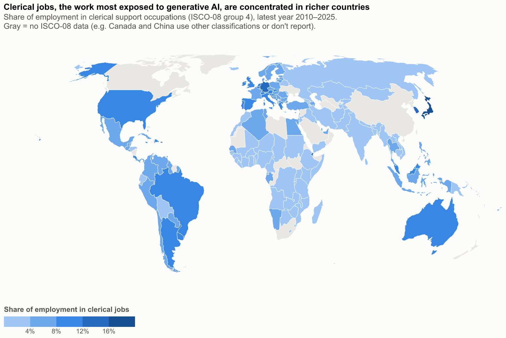
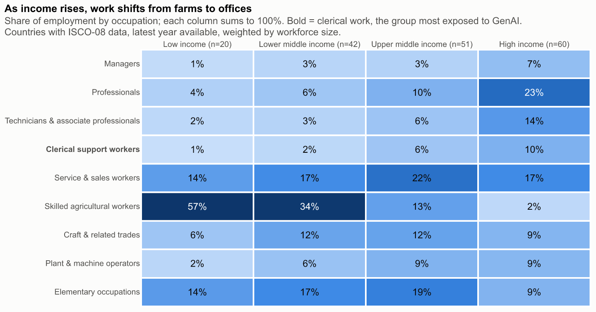
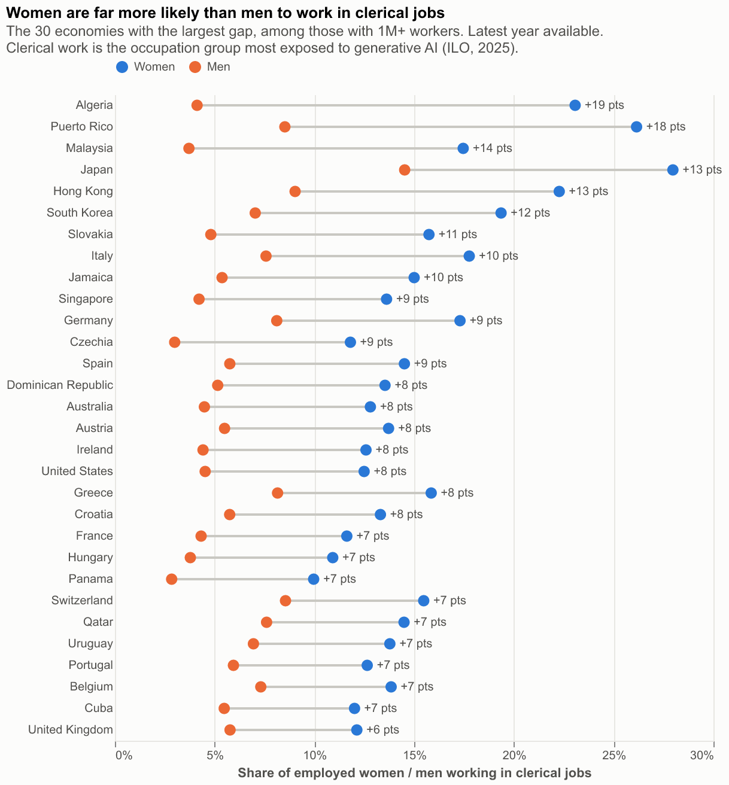
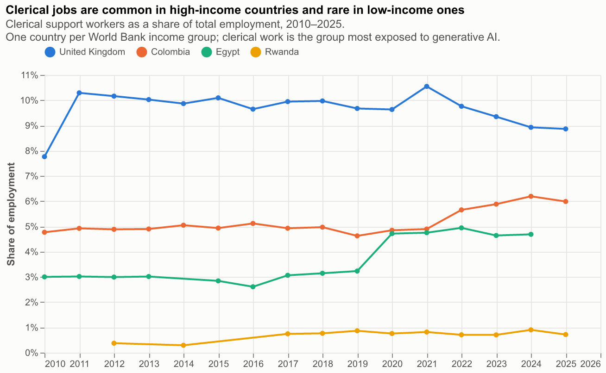
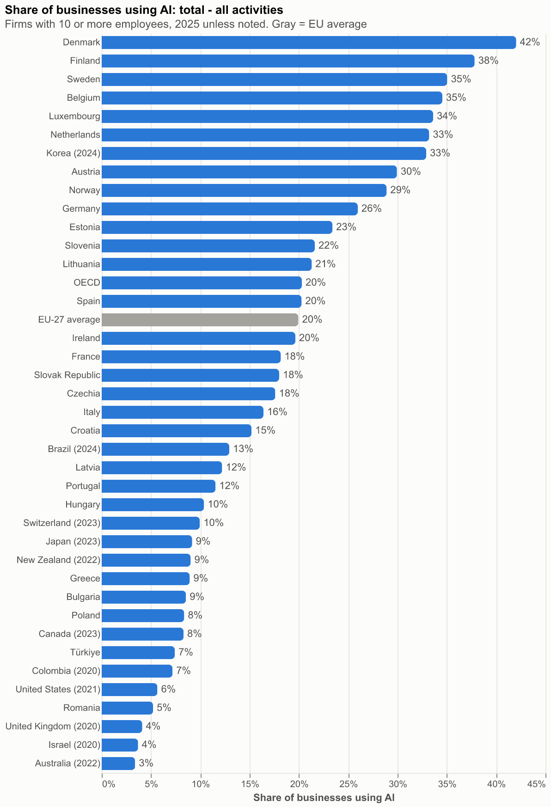
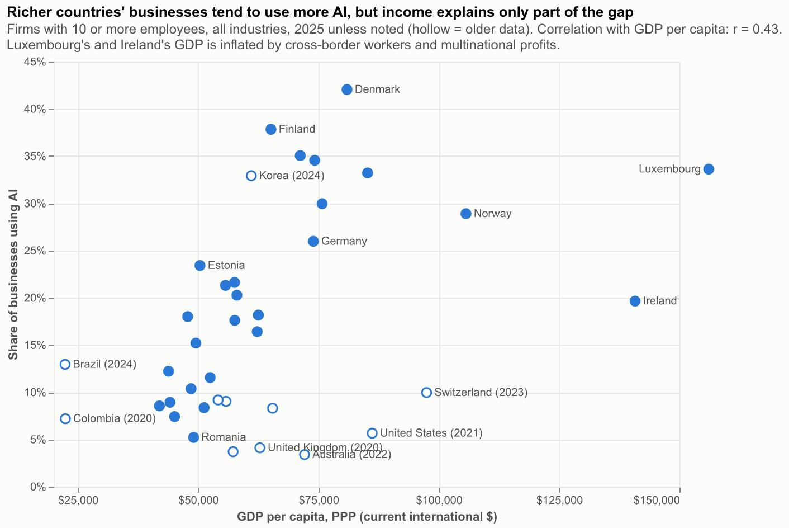
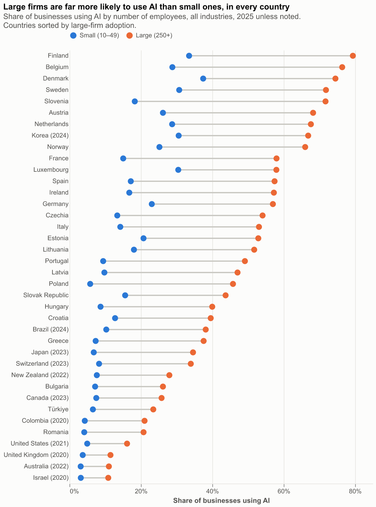
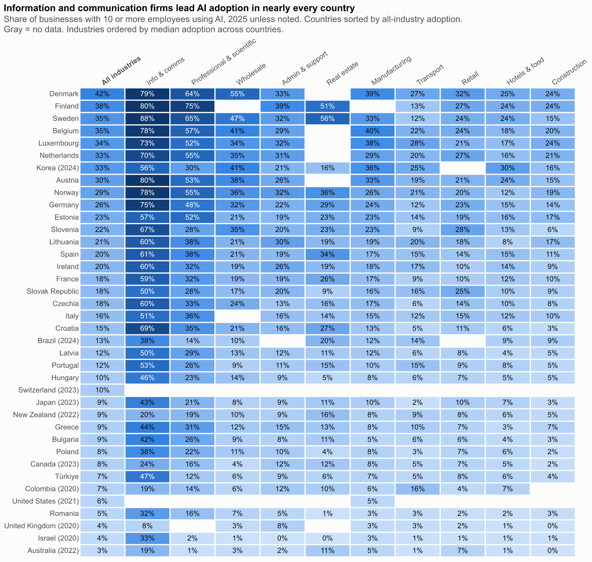

# Predictors of AI Exposure and Measures of Adoption

Lily Rudin

## What is your current goal? Has it changed since the proposal?

The goal has not changed. This project asks whether AI adoption is following existing economic and digital divides, and whether the countries whose workforces are most exposed to generative AI are the ones adopting it least. 

## Are there data challenges you are facing? Are you currently depending on mock data?

There were some challenges importing some of my data sources, current analysis is focused on ILOSTAT (International Labour Organization), OECD ICT Access and Usage by Businesses database and World Bank World Development Indicators.

## Describe each of the provided images with 2-3 sentences to give the context and how it relates to your goal.

### Visualization 1: Clerical Support Workers by Country 

Clerical support work is the occupational group most exposed to generative AI: the ILO finds it has the highest share of tasks that GenAI could potentially automate. Important to note here that exposure measures potential, not actual job loss.

### Visualization 2: Occupation Heatmap

As countries get richer, employment shifts out of agriculture, which falls from 57% of jobs in low-income countries to 2% in high-income ones, and into professional, technical and clerical work. Those office-based occupations, which include the jobs most exposed to generative AI, grow from about 7% of employment in low-income countries to nearly half in high-income countries.

### Visualization 3: Clerical Work by Country and Gender

In all 30 economies shown, women are far more likely than men to work in clerical jobs, the occupation group most exposed to generative AI. The largest gap is in Algeria, where about 23% of employed women work in clerical roles compared with roughly 4% of men, and in Japan the share of women reaches about 28%.

### Visualization 4: Clerical Jobs in High, Medium, Low Income Countries 

Clerical jobs make up about 9–10% of employment in the United Kingdom but less than 1% in Rwanda, with Colombia (5–6%) and Egypt (about 5%) in between. Since 2021 the UK’s share has edged down, while Colombia’s and Egypt’s have risen, narrowing the gap between high- and middle-income countries.

### Visualization 5: Share of Businesses Using AI 

Denmark leads, with 42% of businesses with 10 or more employees using AI, followed by Finland, Sweden and Belgium at 35–38%, well above the EU-27 average of 20%. Several countries at the bottom, including the United States (6%), the United Kingdom (4%) and Australia (3%), only have data from 2020–2022, so their low figures partly reflect how much adoption has grown since then rather than a true gap.

### Visualization 6: GDP per capita x Share of Businesses using AI 

Businesses in richer countries tend to use more AI, but the link is only moderate (r = 0.45): Denmark and Finland adopt far more than Ireland or Switzerland despite similar or lower incomes. Several high-income countries near the bottom, including the United States, the United Kingdom and Australia, only have data from 2020–2022, so their low adoption partly reflects older measurements.

### Visualization 7: AI Use in Small vs Large Firms by Country

In every country, large firms (250+ employees) are far more likely to use AI than small firms (10–49 employees). In Finland, for example, about 80% of large firms use AI against roughly a third of small ones. The gap is widest among the leading adopters, while in countries with older data, such as the United States, the United Kingdom and Australia, adoption is low for firms of both sizes.

### Visualization 8: AI Adoption by Industry and Country 

Information and communication firms are the heaviest AI users in nearly every country, reaching 70–88% in leaders such as Sweden, Finland and Austria, followed by professional and scientific services. Construction, transport, and hotels and food lag far behind, mostly below 25%, and countries that lead overall, like Denmark and Sweden, tend to lead across almost every industry.

## What form do you envision your final narrative taking? (e.g. An article incorporating the images? A poster? An infographic?)

I am envisioning a write-up/article with a couple visualizations and some contextual analysis and supporting figures. I am planning on pairing down to about 5-6 visualizations and creating a stronger narrative to connect these visualizations. 

